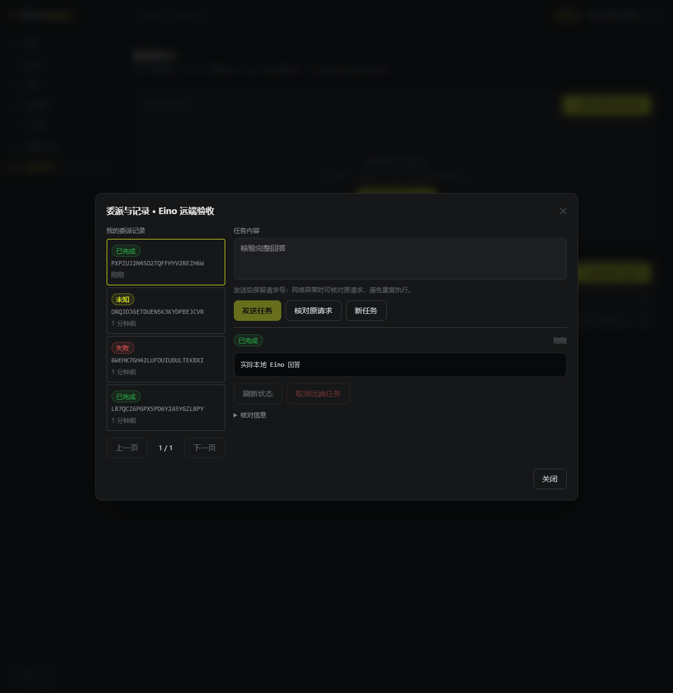

# P3 A2A 验收记录

本记录针对 Task 3 的 A2A 工程化改造。测试使用官方 A2A Go SDK、真实 PostgreSQL/JWT/Hertz/Eino 及受控 HTTP 模型端点；用户尚未配置真实模型服务，因此没有真实模型质量、费用或第三方厂商兼容性通过结论。

## 已验证行为

- 官方 SDK 名片和 JSON-RPC 1.0、1.0.1 peers：发送、异步接受、查询、取消和非完成状态；错误响应 ID、跨 origin、凭据重定向、file URL、超大输出、空完成和响应丢失均有边界测试。
- 真实 PG 任务存储：两名用户隔离、先过滤后分页、版本冲突、终态不可复活、进程中断过期失败和 SDK 已完成 artifact 重读。
- 锁等待超时实际 RED：写事务开始时未超时，等待行锁期间跨过 deadline，原实现仍提交 completed；写入瞬间改为 clock_timestamp fence 后 GREEN。
- 真实 JWT/HTTP 入站：取消停止 Agent、迟到文本不能覆盖取消、失败不泄露部分回答、用户停用即时失去 RPC 权限。
- 退出收尾实际 RED：执行函数返回后任务仍在 submitted，Close 已返回；改为等待 SDK 收尾回调覆盖事件提交后，同一真实 PG 测试连续三次 GREEN（合计 4.940 秒）。
- 管理配置：普通用户/撤销管理员角色被拒绝，凭据加密且 DTO 不回显，配置 CAS、同步与重新启用流程。
- 出站共享预留：16 个并发相同请求号只触发一次远端调用；不同正文冲突、另一管理员无法查询/取消、相同请求在停用后仍能查询原结果；真实 PG 中其他事务预留的单用户容量阻止额外调用，过期后容量可恢复。目标测试 GREEN 3.424 秒。
- 实际 Hertz → 平台委派 → 官方 A2A server → 本地 Chat/Eino → 模型 HTTP → PG 会话/任务完整链路；响应丢失后 unknown，相同请求号不会再触发模型。受控模型损坏 SSE 后失败而非部分成功。
- 实际 cmd/server 进程（真实 PG/Redis/MinIO/Milvus）：完成任务在新进程可查询；强杀未完成任务后，新进程查询其过期失败，没有重跑模型、没有部分完成。Windows GREEN 39.641 秒；Linux SIGTERM 收尾在完整矩阵中单独执行。
- 首轮完整 Linux 矩阵发现实际进程 SIGTERM 退出码 1：Hertz Spin 与主程序各自处理信号，重复 Shutdown 导致 engine is not running。改为由主程序唯一管理信号、通过 Hertz Run 启动 API 后，原实际进程回归 GREEN 47.347 秒；保留此失败记录，不将首轮矩阵记为通过。

## 浏览器

可选真实 HTTP 夹具 `TestA2AHTTPManagementThroughActualLocalEino`，通过 Vite 代理和 Playwright 操作，GREEN 228.004 秒。验证登录、名称修改并保留加密凭据、发送和自动核对完成回答、“核对原请求”、执行中取消、注入模型错误、刷新后历史保留、同步名片、unknown 明确提示。刷新后没有应用控制台错误；登录页首次读取上一个已结束夹具的 refresh token 返回预期 401，随后使用新夹具登录成功。

## 构建与完整矩阵

Windows `go mod tidy`、`go vet ./...`、全单元和四命令 build 通过；前端 typecheck/build 通过（337 modules）。修复信号归属后，完整 Linux 4 CPU / 4 GiB vet、unit race、真实 PG/Redis/MinIO/Milvus integration+infrastructure race 和四命令 build 全部通过，退出码 0：execution 191.809 秒、service 185.311 秒、API 17.288 秒、repo 6.102 秒、ingestion 19.146 秒、vector 5.259 秒、long_term 27.181 秒、tool 2.994 秒、A2A 8.166 秒。CI 已加入 A2A 存储/服务集成与实际 server 进程测试；此处结果来自本地真实 Linux 容器，远端 CI 状态另行核对。

## 结论边界

没有自动恢复中断的 token 生成、exactly-once 外部副作用、第三方 A2A 服务全兼容性、集群共享入站额度或生产容量声明。P3 Task 4 的跨功能验收和 P4 的额度、负载、隔离与发布仍待完成。grpc 从 1.83.1 到 1.83.2 的 Milvus/OTel 回归包含在完整矩阵，不能只凭 A2A 单测宣布兼容。
