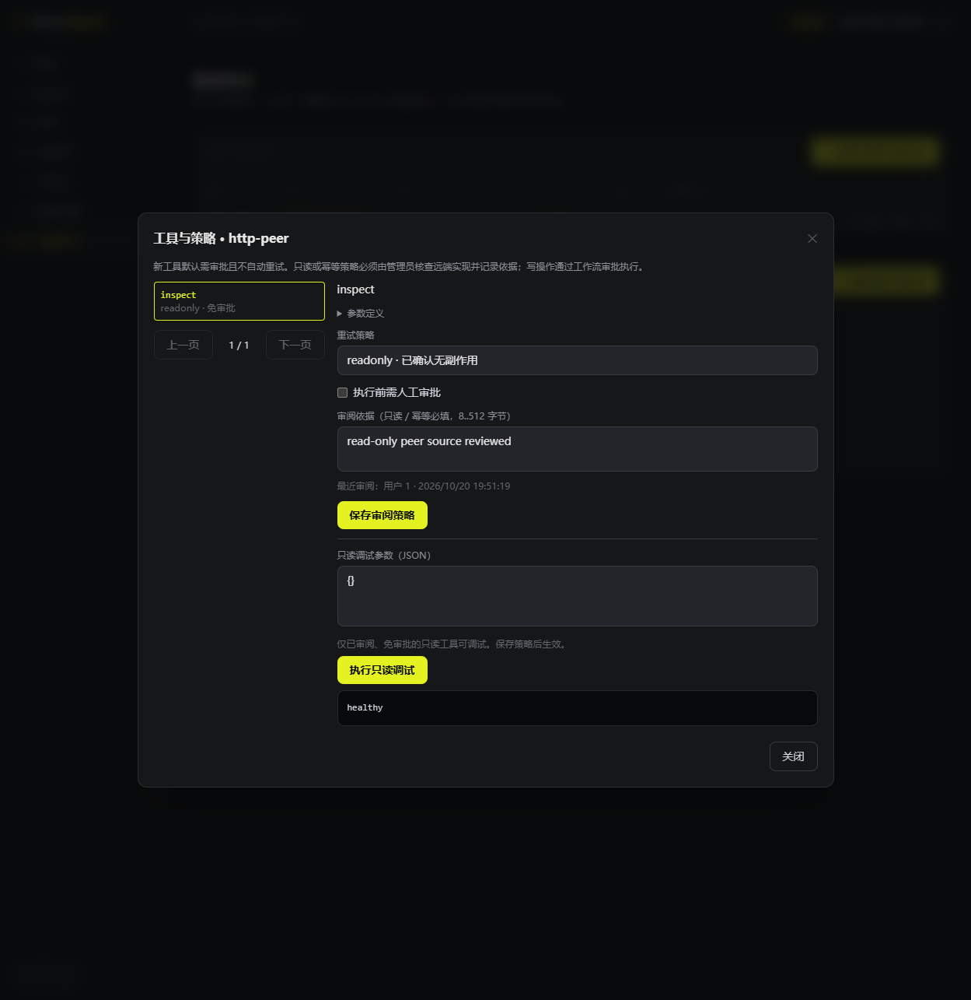

# P3 MCP 验证记录

测试对象为当前生产化分支的 MCP 协议、服务授权、工作流绑定和管理界面。P3 任务仍需完成 A2A 与全平台联调，不能把本记录当作整体生产就绪证明。

| 层级 | 已执行结果 |
| --- | --- |
| 协议对端 | 官方 Go SDK 1.8.0 服务；现代/旧版 × JSON/SSE，三页完整发现、八并发、会话生命周期、请求/响应/Schema 上限 |
| 网络故障 | 丢失工具响应后远端效果 1 次；工具 POST 无隐式重放；isError/部分文本保持失败语义 |
| PostgreSQL | 密钥加密/脱敏、旧数据显式迁移、稳定 ID、目录事务失败回滚、权限撤销、配置/绑定 CAS、移除工具失效 |
| Eino | 真正 Eino Runner：模型发出调用 → 已恢复的 MCP 工具 → 模型收到实际返回 → 单一完成事件；模型为受控 HTTP 对端 |
| worker 进程 | 实际构建并运行 cmd/worker；启动后新增工具、重启恢复；已审批写操作远端执行后杀进程，替代进程 needs_attention，副作用 1 次，25.360s |
| HTTP/JWT | 真实 Hertz TCP + JWT + PG + 官方 MCP 对端，创建/迁移/同步/分页/审阅/冲突/只读调试；旧 admin JWT 在数据库撤权后返回 403，3.935s |
| 浏览器 | 登录、同步工具数、新工具禁止直接调试、只读审阅/调用返回、配置名称保存和刷新、凭据不回显；最终完整 fixture PASS 176.819s（含人工式 UI 操作等待） |
| Windows | go mod tidy、go vet ./...、go test ./...、四个命令构建全部成功；前端 TypeScript + Vite 构建成功 |

观察到的 RED → GREEN 包括：旧客户端只拿一页；无绑定直接调用成功；最后检查后切换绑定仍产生远端效果；旧目录升级继承未经审阅的只读策略；010 对既有报表工具使用不合法枚举；仅修改名称绕过编辑 CAS；新增无关工具误使旧授权失效；调试接口绕过写审批；有效 MCP 参数头注解被 Eino 拒绝；同步发布 Eino 无法加载的 Schema；超大绑定 JSON 未设上限。

浏览器首轮 fixture 的固定计数断言误把 UI 新增的合法调用当作越权调用。修正为比较撤权前后计数，重新运行最终 fixture 通过；该次是验收脚本修正，不是权限实现复现出的缺陷。开发服务器新增文件的样式热更新未正确刷新，重启后重新截图检查，最终双栏布局正常。

Linux 4 CPU / 4 GiB 最终完整矩阵退出码 0：go vet、全包单测 race、真实 PG/Redis/MinIO/Milvus 集成 race 和四个命令构建全部通过。集成包耗时：execution 139.918s、service 173.631s、api 13.514s、repo 5.608s、ingestion 16.999s、vector 5.422s、long_term 22.841s、tool 3.143s。协议单测 race 包 mcp 1.171s。当前没有真实模型服务，模型质量、真实费用和生产吞吐未验收；上述耗时为测试包或人工式操作的运行时间，不能解释为接口延迟。
