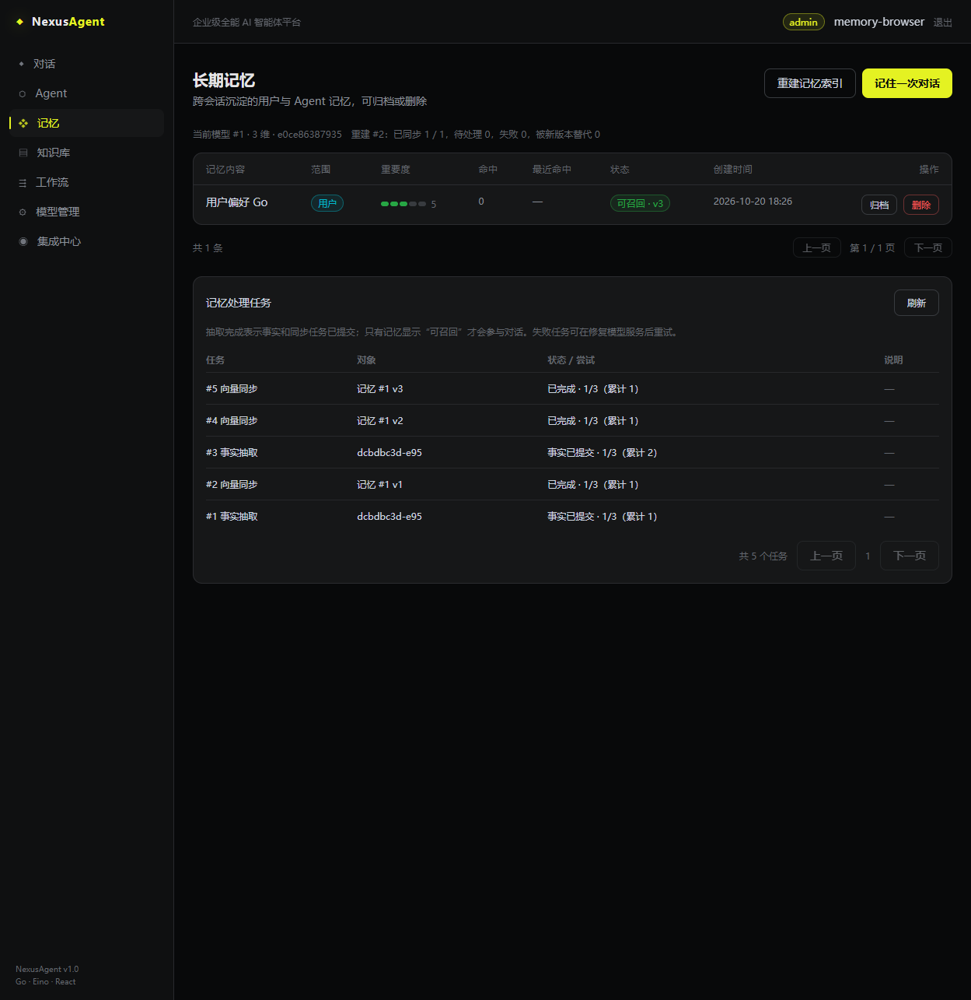

# P3 长期记忆验证记录

这是 P3 数据阶段的记忆交付记录，不代表 MCP/A2A、整站验收或 P4 容量目标已经完成。模型对端为可控 HTTP 服务；PostgreSQL、Milvus、Redis 与独立 worker 进程均为真实依赖。真实模型尚未配置，事实抽取质量、真实费用和模型延迟未验收。

## 已观察到的功能结果

| 验证 | 结果与边界 |
| --- | --- |
| 源去重、阈值与归属 | 同一消息边界/模型空间/抽取配置返回同一任务；阈值只统计新消息；他人会话拒绝 |
| 决策先持久化 | 事实与操作决策分阶段保存；元数据变更、操作记录和向量任务在同一 PG 事务提交 |
| 部分同步失败 | 第二条记忆向量化失败时不被召回；恢复后两条逻辑记忆对应两条真实向量，已保存事实阶段不重复调用模型 |
| 操作顺序与 UPDATE | 对端故意返回 ADD/UPDATE/DELETE 重排数组；ADD 使用实际新内容；UPDATE 的真实向量与新内容方向匹配；DELETE 清理旧向量 |
| 模型空间迁移 | 固定三维空间不随普通模型配置编辑漂移；显式重建到四维后正确召回，旧空间向量清零 |
| 连续迁移 | A→B→C 时被替代的 B 任务仍清理 A、B；A→B→A 时不会删掉当前 A 的向量，真实 Milvus 回归通过 |
| 独立进程崩溃 | 实际 `cmd/worker -queues memory` 在远端 Upsert 后、PG 提交前强杀；默认租约到期后替代进程完成。事实调用一次、向量调用两次、逻辑向量仍一条 |
| 权限与失效 | ANN 前限定 owner、当前 Agent/全局范围与发布 revision；PG 再校验。归档撤销召回并排队清理；Agent 被撤销后旧抽取不能提交 |
| 真实 HTTP | 全量路由、JWT、PG、Milvus、worker 验证抽取、任务查询、非法模型响应失败、显式重试、幂等重建、归档、删除；他人任务/重建查询与重试返回 404 |
| 实际浏览器 | 登录→记忆页→确认模型重建→显示“可召回 v3”和完成计数→手动抽取去重→归档及清理→删除→刷新仍无该记忆；无新增功能性控制台错误，存在原页面 favicon 404 |

## 验证中发现并修复的问题

实际 worker 进程首先暴露了 PG 连接协议差异：原测试夹具启用 simple protocol，而服务使用预编译协议。数字直接绑定到 `::text` 时，实际服务无法编码参数。已把数字锁键参数明确转换为 `bigint::text`，并让测试连接使用生产默认协议；文档、记忆、repo、服务和 API 的真实 PG 回归全部通过。

连续重建回归曾观察到 A、B 两个旧空间各残留一条向量。修复后，过期任务继续履行自己记录的旧空间清理责任，同时保护已重新成为当前空间的 A；两种真实 Milvus 场景通过。仅撤销召回资格不能替代远端清理验证。

## 当前验证命令

Windows 已运行 `go vet ./...`、全包单测和真实 PG/Milvus/HTTP/进程测试；管理页通过 TypeScript 检查和 Vite 生产构建。

Linux 验证容器限制 4 CPU / 4 GiB，使用独立的真实 PG16、Redis7.2.4、MinIO、Milvus2.5.6：`go vet ./...`、全包 `go test -race ./...` 通过；带 `integration infrastructure` 标签的 execution / service / api / repo / ingestion / vector / long_term 包分别通过 108.850 / 158.432 / 11.716 / 5.373 / 16.596 / 5.293 / 21.181 秒。service 包包含固定 100 查询评测及本次记忆链路。此时间是测试运行时长，不是业务接口延迟或平台吞吐。

同一 Linux 验证命令最终执行 `go build ./cmd/server ./cmd/worker ./cmd/cli ./cmd/migrate`，进程退出码 0。CI 已加入记忆 PG、权限范围、真实向量链路、HTTP 和独立进程恢复检查。

日常操作及故障恢复见 [记忆执行手册](memory-runtime-runbook.md)。
