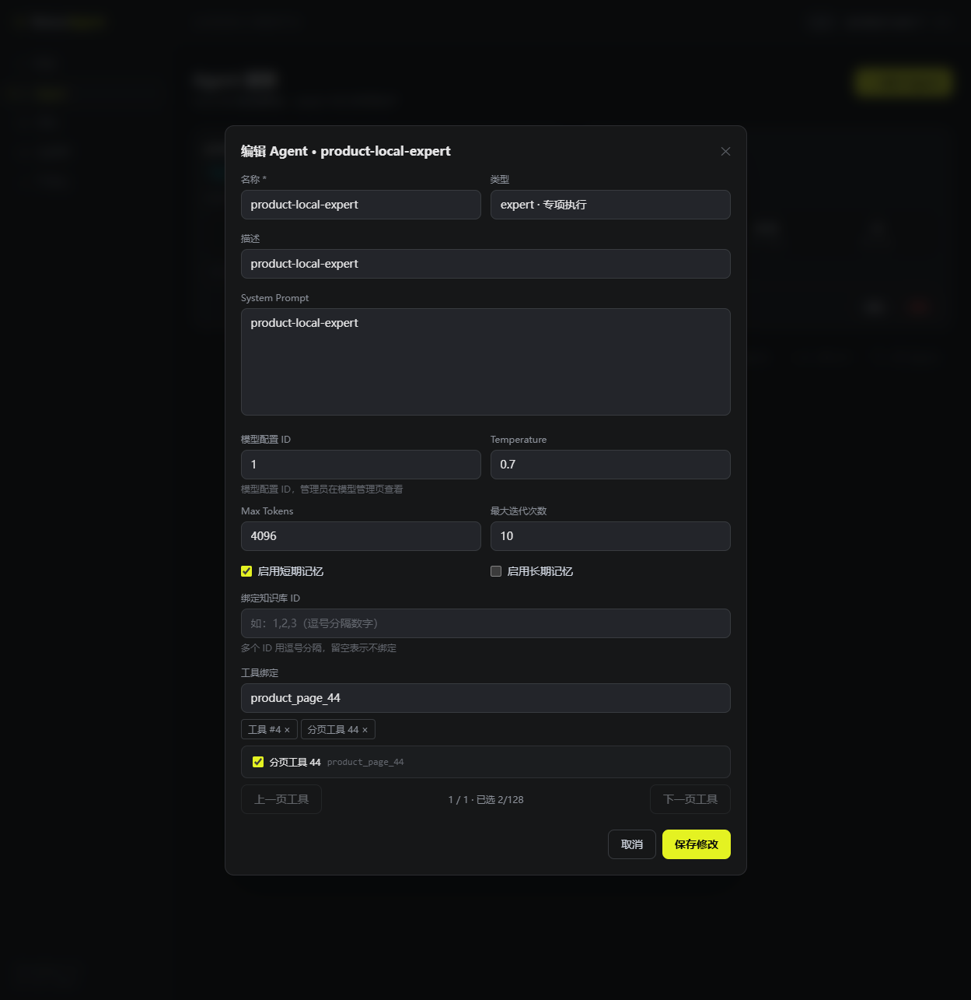
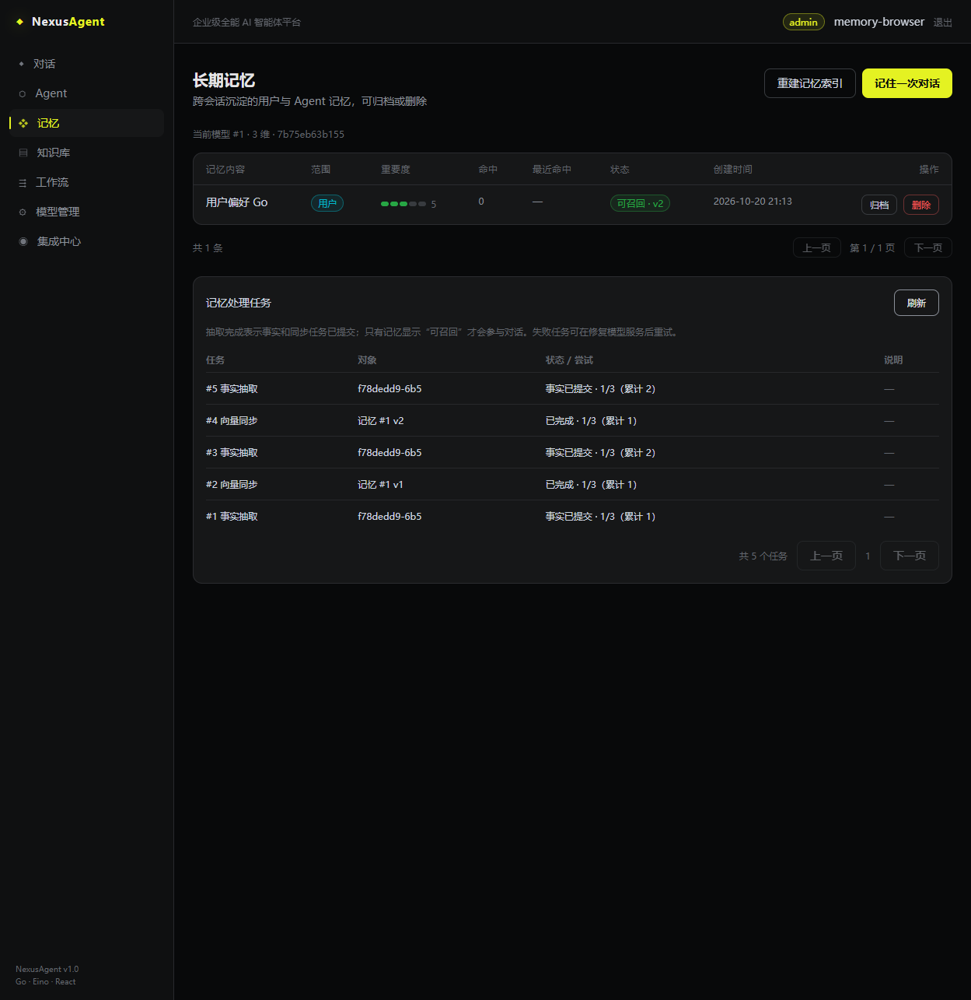

# P3 产品与数据集成验收

## 结论范围

Go/Eino 平台已补齐文档任务、检索与记忆一致性、MCP 和 A2A 的可用产品链路。验收使用真实 PostgreSQL、Redis、MinIO、Milvus、HTTP/SSE、官方协议 SDK、实际 server/worker 进程以及浏览器；模型端点是受控 HTTP 服务。用户确认暂未配置真实模型，因此模型实际回答质量、费用与真实厂商兼容性尚未验收。

以下按功能分别执行，不能理解为同一用户在一个长会话中一次走完所有功能。单进程资源限额测试也不能代替 P4 的整个平台容量结论。

## 功能证据

| 功能 | 实际验证与边界 | 记录 |
| --- | --- | --- |
| Agent / Host / 工具 | 两名用户真实注册登录；HTTP Host 选择本用户专家 → Eino 请求工具 → 接收实际工具结果 → 最终 SSE 回答和 PG 消息；模型调用 3 次，工具 1 次；另一用户专家名称/提示词未进入模型请求 | `TestProductToolsAndFreshJWTAuthority` |
| 持久工作流 | PG 快照/checkpoint/审批/outbox；真实 worker 强杀/替换、审批中断恢复、丢失写响应进入人工核对、Redis 断网仍以 PG 推进 | [P2 验收](2026-10-20-p2-validation.md) |
| 文档与索引 | MinIO 原文 → 有界解析/分块 → 固定 embedding 身份 → Milvus；中断、重试、版本切换、ready 发布及失败可见；PDF 仍需 P4 进程隔离 | [文档验收](2026-10-20-p3-documents-validation.md) |
| 检索 | 向量召回前作用域隔离及 PG 再校验；固定 100 查询中含无答案/越权反例；记录真实排序和降级，不将 ILIKE/TF-IDF 称为 BM25 | [检索验收](2026-10-20-p3-retrieval-validation.md) |
| 长期记忆 | 事实/向量持久任务、跨 revision 迁移和清理、实际 worker 在 upsert 后提交前被杀；UI 已补验失败任务同 ID 重试 | [记忆验收](2026-10-20-p3-memory-validation.md) |
| MCP | 官方现代/旧协议 peers、完整分页/错误/并发/结果上限；加密凭据、事务同步、动态权限、worker 重启及新工具；实际 Eino 和写审批故障验证 | [MCP 验收](2026-10-20-p3-mcp-validation.md) |
| A2A | 官方 SDK JSON-RPC、真实 JWT 所有权、PG 任务、加密配置、先预留再委派、相同请求号不重发、unknown 核对、取消/重启/退出 | [A2A 验收](2026-10-20-p3-a2a-validation.md) |
| 身份与工具列表 | 实际 RED 证明旧 JWT 保留降权权限、停用用户能刷新、工具分页越权和 ID 绑定绕过；修复后通过同一真实 HTTP 回归 | 本节后文 |

具体测试路径在 `backend/internal/api`、`service`、`execution`、`ingestion`、`vector` 和 `a2a`。CI 运行自动化矩阵；浏览器夹具通过显式环境变量单独启用，控制接口与公开测试密码不进入生产服务。

## 跨功能验收中修复的缺陷

工具选择接口曾直接分页全部工具，普通用户能看到无权访问的 MCP，未注册工具和执行私有配置也进入响应；Agent 只校验 tool_code，前端提交的 tool_id 绕过校验。现在先按当前用户、MCP 授权/启停/版本/策略及本进程可执行能力过滤，再计算 total 和分页，只投影公开定义。绑定 ID 和 code 统一走实际执行器校验，执行前仍复查。未注册处理器不能先向模型承诺该工具可用。

通用 API 原来只校验 JWT 签名，管理门禁使用旧 role；Refresh 同样复制旧角色。现在生产路由每次查询当前用户状态/角色，失效账号返回 401，数据库异常拒绝访问；Refresh 使用当前身份。MCP/A2A 原有的每次调用授权继续保留。此项新增查询开销必须包含在 P4 控制接口时延中，不能在压测时移除鉴权。

同一真实 PG/Redis/Hertz 测试见证全部问题 RED，修复后 GREEN 3.444 秒；补入实际 Host/Eino/工具链路后 GREEN 3.018 秒。既有 API/service/tool 单元及 MCP/A2A 相关集成复查通过。

## 浏览器补验

Agent 工具选择使用 46 个实际可用工具验证三页列表：第二页选择并保存，刷新后绑定仍保留；搜索到第三页工具，明确移除页外选择，再保存。私有、停用和未注册工具不进入普通用户选择器。夹具 `NX_PRODUCT_BROWSER=1` 通过 139.742 秒。

记忆任务 #5 因受控坏模型响应变为 failed；模型恢复后点击真实“重试”按钮，同一任务号变为 done，RetryEpoch=1，累计执行 2 次。PG/Milvus/真实 HTTP 夹具 `NX_MEMORY_BROWSER=1` 通过 86.295 秒。

## 复现与尚未完成项

Windows PowerShell 使用 `./scripts/verify-p3.ps1`，可传 `-ModuleCache <本机 Go 模块缓存目录>` 复用下载。脚本启动独立 Compose 依赖，在 4 CPU / 4 GiB Linux Go 容器执行 vet、全 unit race、真实数据/进程矩阵和四命令 build，再执行前端锁文件安装、typecheck/build。`-Checks Backend` / `-Checks Frontend` 可单独复查。前端依赖重装前需停止此 checkout 的 Vite，脚本会提前检测 Windows 原生模块占用。它不清理保留的验证资料或无关容器。脚本的自动化结果不包含人工浏览器或真实 LLM 验收。

本次身份/列表改动的完整 Linux vet、unit race、真实 PG/Redis/MinIO/Milvus integration+infrastructure race 与四命令 build 全部通过（4 CPU / 4 GiB，退出码 0）：execution 193.450 秒、service 187.852 秒、API 23.882 秒、repo 6.402 秒、ingestion 21.152 秒、vector 4.414 秒、long_term 25.706 秒、tool 3.060 秒、A2A 7.833 秒。前端 typecheck/build 通过；复现脚本本身另作最终门禁运行。

一键脚本的实际运行中，后端完整矩阵再次通过（execution 198.750 秒、service 187.781 秒、API 22.470 秒）；随后 npm ci 被仍运行的 Vite 占用的 lightningcss 原生模块拒绝，错误为 Windows EPERM，并非测试通过或自动审批拒绝。停止本次验收的预览进程后，锁文件重装、typecheck/build 通过（337 modules、npm audit 报告 0 vulnerabilities）。未改动后端代码，只单独复查前端；新增提前占用检查及按检查项复查参数。该次失败日志保留，没有将失败的一键调用记成整体通过。

P4 的共享全局/用户/提供方额度、上下文模型窗口、PDF 进程隔离、开放到达率压力实验、部署与回滚、全分支审阅仍需完成。当前不能据此宣称已满足 200 SSE / 32 slots / 10 runs/s、30 分钟的容量目标。
